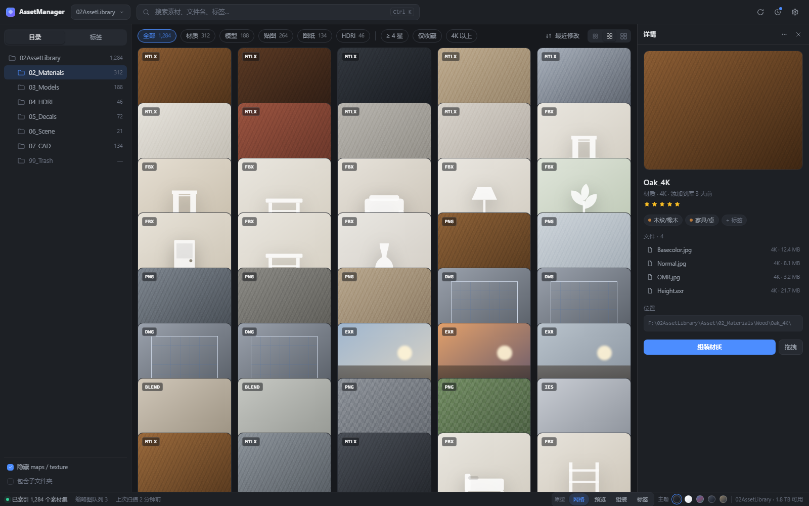
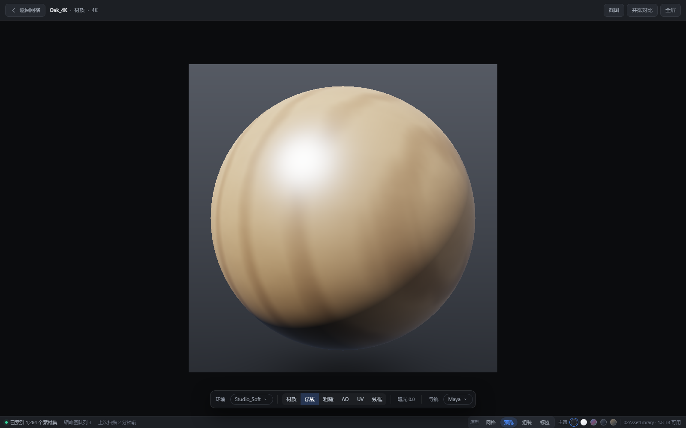
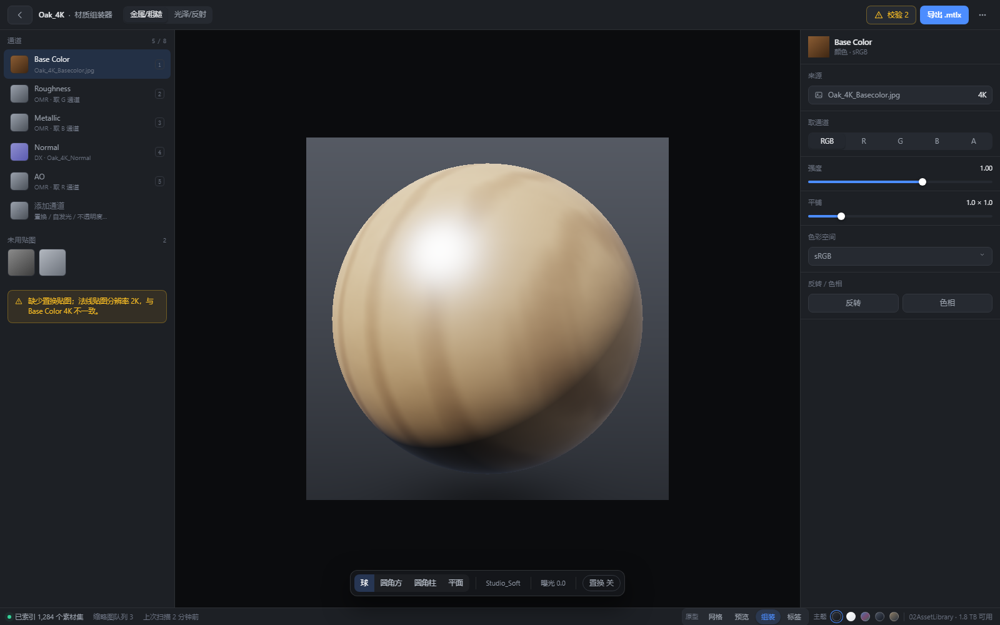

# AssetManager

[](LICENSE)
[](https://github.com/OMEN111111/AssetManager/releases)

本地 3D 资产库管理器：把散落在硬盘里的 **模型 / 材质 / 贴图 / 图纸 / HDRI / IES** 统一索引，提供预览、检索、标签与整理能力。纯本地运行，不上传任何文件。



## 功能

- **本地索引**：扫描素材库目录，识别材质（.mtlx / 贴图文件夹）、模型（.fbx 等）、贴图、CAD 图纸、HDRI、IES，写入本地 SQLite；文件监听让外部改动自动重扫。
- **素材网格**：缩略图、类型/格式/评分/收藏/标签筛选、目录树、分页、批量操作、双击放大与滚轮缩放。
- **实时预览**：
  - 模型：FBX 加载、PBR 贴图、白膜/法线/粗糙/金属/AO/颜色/自发光/棋盘格通道、线框叠加、UV 视口（多材质分格、UDIM、UV 集切换）、材质球与贴图面板、HDRI 照明、光照球。
  - 材质组装器：通道拼装、整体 UV（平铺/旋转/位移）、强度（−1…1，负数反相）、HSL、法线 GL/DX、贴图缩略图、通道预览、贴图导出与降级、.mtlx 导出。
  - HDRI 全景预览、IES 灯光预览。
- **标签体系**：两级标签、资源管理器式多选（Ctrl/Shift）、多标签 AND 筛选、批量改色/移动/删除。
- **库维护**：库体检（缺失贴图/预览/断链）、问题素材标记与忽略、整理（规范化目录）、导入去重、缩略图补全。
- **外观**：多主题（深色/浅色/透明/玻璃/图片）、无边框窗口与自绘标题栏、插件管理面板。

| 模型预览 | 材质组装器 |
| --- | --- |
|  |  |

## 发送到 DCC

详情页和右键统一一个入口「**→ 发送到…**」，弹层列出已连接的软件（未连接的也能发，任务排队等它启动）。
队列走本地 HTTP，插件轮询取任务、回传结果，软件换端口时插件自动跟随。

| 目标 | 插件 | 能做的事 |
| --- | --- | --- |
| 3ds Max | `bridge/max/`（MaxScript） | 拖放导入放置、打包选中、材质重建 |
| Blender | `bridge/blender/<Blender 版本>/`（Python，5.2 / 4.0 / 3.6） | 模型导入、PBR 材质重建、发送贴图 |
| SketchUp | `bridge/su/<SketchUp 版本>/`（Ruby，2026） | 模型导入、原生 PBR 材质、发送贴图、**HDRI 环境** |

- 插件按 DCC 版本分目录，各自独立编号（与软件版本解耦），插件面板里可一键安装到本机所有版本。
- **FBX/OBJ 自动转 GLB**：SketchUp 没有 FBX 导入器，发这类模型时软件先用 three.js 临时导出成 GLB
  （单位按 FBX 的 `UnitScaleFactor` 折成米，贴图随 GLB 嵌入），再交给 SketchUp 导入。
  转换只写数据目录 `converted\`，素材文件不动。

## 技术栈

- Electron 35（`frame: false` 自绘标题栏）+ React 18 + TypeScript
- Vite 6 构建渲染层，esbuild 打包本地 HTTP 服务
- three.js r186：PBR、PMREM、IES、UV/通道预览、FBX→GLB 转换（loader + GLTFExporter）
- `node:sqlite`（Node 22 内置）保存索引，无需额外数据库

## 目录结构

```
app/               应用本体
  electron/        主进程与 preload
  src/server/      本地 HTTP API + 静态服务
  src/core/        数据库、扫描器、桥接队列
  src/renderer/    React 界面（App / Viewer / Assembler / matlib / geometries / glbconvert）
  bridge/          DCC 插件：max/（MaxScript）、blender/<版本>/（Python）、su/<版本>/（Ruby）
  build/           构建产物与图标（server.mjs 由构建生成）
prototype/         早期界面原型与截图
devtest/           开发期的 CDP 验证脚本与测试页
```

> 需求/设计文档（`docs/`）与版本记录（`Logs/`）只保留在本地开发环境，不随仓库与安装包发布。

## 开发

需要 Node.js 22+、pnpm。

```bash
cd app
pnpm install
pnpm build:all        # 构建渲染层 + 本地服务
pnpm app              # 启动 Electron
```

浏览器内调试（无 Electron 外壳）：

```bash
pnpm dev:api          # http://127.0.0.1:8787
pnpm dev:web          # Vite 开发服务器（可用 AM_API 指向别的实例）
```

插件测试：

```bash
# Blender（本机 5.2）：系列同步检查 + 无 Blender 冒烟
cd app/bridge/blender && node tools/sync-blender-bridge.mjs --check && python tools/smoke_test.py

# SketchUp：装进 Plugins 后，在 SketchUp 的 Ruby 控制台里
#   load "D:/Program/AssetManager/app/bridge/su/tools/test_su.rb"
```

## 打包

```bash
cd app
pnpm build:all
pnpm dist             # electron-builder：NSIS 安装版 + 便携版
```

产物在 `app/release/`。Windows 未签名，首次运行可能触发 SmartScreen。

## 数据位置

- 开发/便携运行：`app/data/library.db`、`app/data/thumbs`
- 安装版：`%APPDATA%\assetmanager-app\`（`converted\` 里是给 DCC 临时导出的模型，会自动清理）

素材文件本身始终留在原目录，软件只写索引与缩略图。

## 许可

[MIT](LICENSE)
