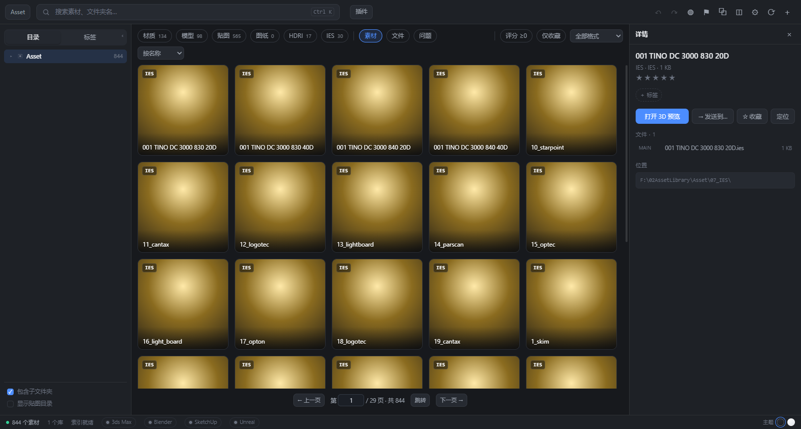
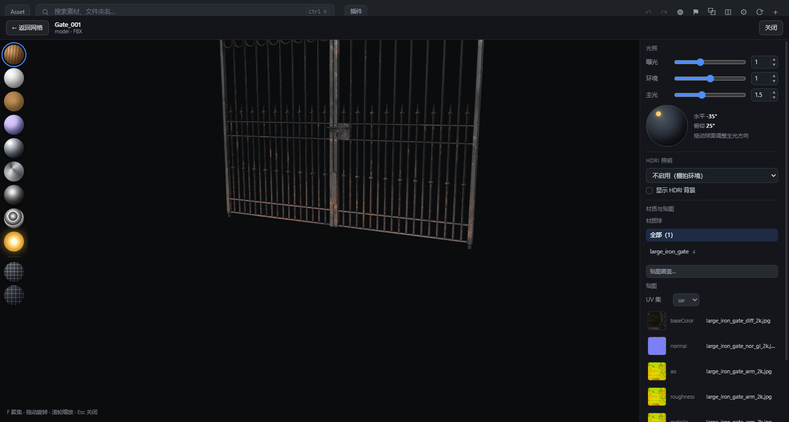
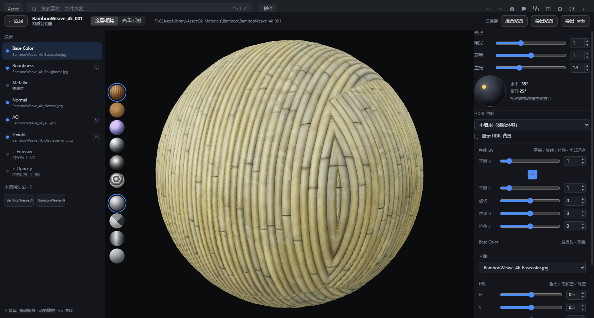
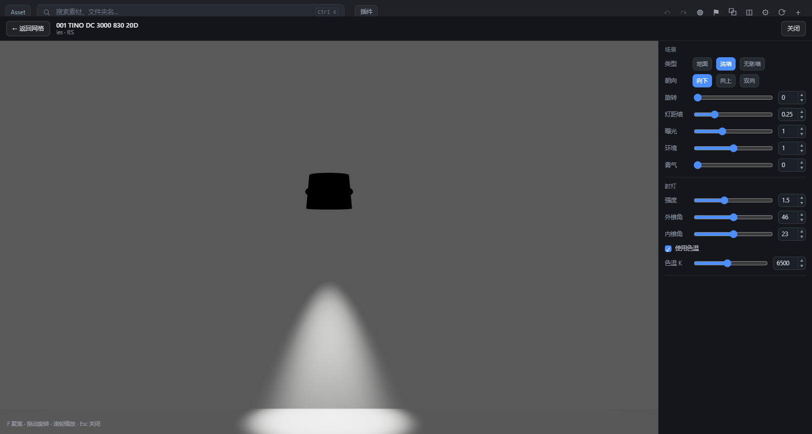
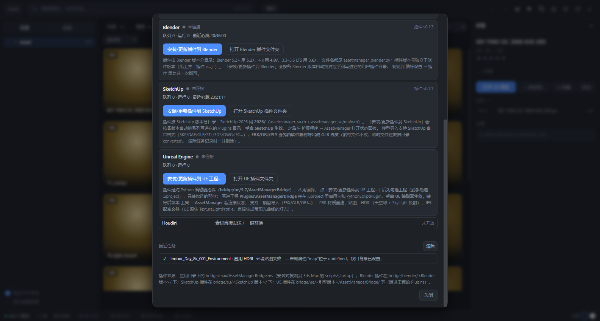

# AssetManager

[](LICENSE)
[](https://github.com/OMEN111111/AssetManager/releases)

本地 3D 资产库管理器：把散落在硬盘里的 **模型 / 材质 / 贴图 / 图纸 / HDRI / IES** 统一索引，提供实时预览、材质组装、标签与整理，并把素材一键发到 **3ds Max / Blender / SketchUp / Unreal Engine / Maya**。
纯本地运行，素材文件只读，不上传任何内容。



| 模型预览 | 材质组装器 |
| --- | --- |
|  |  |

| IES 灯光预览 | 插件管理（四个 DCC） |
| --- | --- |
|  |  |

## 功能

### 索引与浏览
- **本地索引**：扫描素材库目录，识别材质（`.mtlx` / 贴图文件夹）、模型（FBX/OBJ/GLB）、贴图、CAD 图纸、HDRI、IES；写入本地 SQLite。
- **按文件后缀分类**：模型就是模型（场景也归模型），筛选不会因为目录名“看起来像场景”而串类型。
- **增量重扫**：外部增删文件后自动重扫，素材/文件 id 保持稳定，不会出现“预览图消失 / 3D 预览变成别的模型”。
- **筛选与整理**：类型 / 格式 / 评分 / 收藏 / 标签 / 搜索 / 排除项；分页可直接输入页码跳转。
- **库维护**：库体检、问题素材标记与忽略、整理（规范化目录，只作用于当前目录子树）、补缩略图。

### 预览
- **模型**：PBR 贴图、通道预览（白膜 / 法线 / 粗糙 / 金属 / AO / 颜色 / 自发光 / 棋盘格）、线框、UV 分屏、多材质与 UDIM、HDRI 照明、主光球。
  TIF/TGA 贴图会先解码成 PNG 再上材质；ASCII FBX 会给中文提示（不自动转换）。
- **材质组装器**：通道拼装、打包图取通道（RGB / R / G / B / A）、整体 UV（平铺 / 旋转 / 位移）、强度（负数反相）、HSL、法线 GL/DX、贴图导出与 `.mtlx` 导出。
- **HDRI**：全景预览、亮度/旋转、作为环境照明。
- **IES 灯光查看器**：按 IES 文件**逐像素**还原配光（不是贴图投影）；聚光灯内外锥角、0–360° 旋转、色温（默认 6500K）/ HSL、雾气与体积光；
  场景可选「地面 / 洗墙 / 无影墙（带天花板与圆弧过渡）」，灯具朝向支持向下 / 向上 / 双向。
- **预览图**：模型预览白底、材质预览透明底；整理里可把过大的预览图压到 ≤1024 并生成 512 网格缩略图。

### 素材整理
- 两级标签、资源管理器式多选（Ctrl/Shift）、批量评分/标签/移动/删除。
- **工作区**：软件产生的文件（DCC 转换、插件副本、自定义基本体、拖放描述、缩略图缓存）统一放在可自定义的工作区，换路径时自动迁移。
- **图片直接拖出**：贴图/材质预览图可拖进 Photoshop、聊天框、浏览器上传区；模型仍拖 `.ms` 给 3ds Max。

## 发送到 DCC

详情页和右键统一一个入口「**→ 发送到…**」，弹层列出五个目标（未连接的也能发，任务排队等它启动）。
队列走本地 HTTP：插件约 0.8 秒轮询取任务、5 秒心跳、执行后回传结果；软件换端口时插件自动跟随
（读 `%LOCALAPPDATA%\AssetManager\bridge.json`，探不通则回退扫描 8787–8805）。

| 目标 | 插件 | 能做的事 |
| --- | --- | --- |
| 3ds Max | `bridge/max/<Max 版本>/AssetManagerBridge_<插件版本>.ms`（MaxScript 0.2.1，2026 / 2027 实测） | 拖放导入放置、打包选中、材质重建、HDRI（环境贴图 / 视口背景）、**导回源目录（按 UUID 覆盖模型+贴图）** |
| Blender | `bridge/blender/<版本>/`（Python 0.1.5，5.2 / 4.0 / 3.6） | 模型导入、PBR 材质重建、贴图、HDRI 世界环境 |
| SketchUp | `bridge/su/2026/`（Ruby 0.1.2） | 模型导入（FBX/OBJ/PLY 自动转 GLB）、原生 PBR 材质、贴图、HDRI 环境 |
| Unreal Engine | `bridge/ue/<引擎版本>/`（Python 编辑器插件 0.1.7，5.6 / 5.7 / 5.8） | 模型导入（静态 / 骨骼 / 物理资产）、PBR 材质（可指定父材质建实例）、贴图、HDRI 天空球 + SkyLight、**IES 灯光** |
| Maya | `bridge/maya/<Maya 年份>/`（Python 模块 0.1.0，2025） | 模型导入（FBX / OBJ / MA / MB / ABC / USD）、PBR 材质（原生 `standardSurface`）、贴图、HDRI（Arnold 天空穹灯 / 无 Arnold 时环境球）、**IES 灯光**（Arnold） |

- 插件按 DCC / 引擎版本分目录、各自独立编号（与软件版本解耦），插件面板里可一键安装。
  UE 插件装进**你勾选的工程的 `Plugins/`**（并在 `.uproject` 里启用它和 `PythonScriptPlugin`），重启编辑器生效；
  Maya 插件写进 `Documents\maya\<年份>\modules`（只动用户目录，不碰 Maya 安装目录、不改 `Maya.env`），重启 Maya 生效。
- **FBX/OBJ 自动转 GLB**：SketchUp 没有 FBX 导入器，发这类模型时软件先用 three.js 临时导出成 GLB
  （单位按 FBX `UnitScaleFactor` 折成米、贴图随 GLB 嵌入），只写工作区 `converted\`，素材文件不动。
- **材质重建用各 DCC 原生材质**：SketchUp 走原生 PBR，打包图按通道抽灰度；UE 用 `MaterialEditingLibrary` 连节点；
  Maya 用原生 `standardSurface`（不依赖 Arnold，打包图只建一个 file 节点、按 R/G/B 取通道）；
  同名材质原地重建不堆 `.001`，不覆盖用户同名材质。
- **IES 支持 UE 与 Maya**（UE：`TextureLightProfile` → 灯光 IES 槽；Maya：Arnold `aiPhotometricLight`），其它目标不提供 `ies` 模式。

## MCP（AI 客户端接入）

软件内置 MCP Server（默认开启，设置 → MCP 可关）：

- HTTP：`http://127.0.0.1:8787/mcp`
- stdio：设置里显示的 `mcp-stdio.mjs`（给 Claude Desktop 等只支持 stdio 的客户端）

工具：`search_assets`、`get_asset`、`list_tags`、`assign_tags`、`update_asset`、
`send_to_dcc`（max / blender / su / ue，模式 import / material / texture / hdri / ies）、`rescan_library`、`bridge_status`。
默认**只读**，写操作需在设置里勾选「允许 AI 修改」。

## 技术栈

- Electron 35（`frame: false` 自绘标题栏）+ React 18 + TypeScript
- Vite 6 构建渲染层，esbuild 打包本地 HTTP 服务（Electron 以 `ELECTRON_RUN_AS_NODE=1` 拉起）
- three.js r186：PBR、PMREM、HDRI/EXR、IES 逐像素配光、UV/通道预览、FBX→GLB 转换
- `node:sqlite`（Node 22 内置 `DatabaseSync`）保存索引，无需额外数据库
- 桥接：本地 HTTP 队列 + 文件路径传递（大文件不走 HTTP），只监听 `127.0.0.1`

## 代码地图

| 文件 | 职责 |
| --- | --- |
| `app/electron/main.cjs` | 主进程：窗口/托盘/菜单、拉起本地服务、拖拽导出、自动重载兜底 |
| `app/src/server/index.ts` | 全部 HTTP API：assets / asset / thumb / file / tree / stats / texture / variants / issues / tags / preview / organize / workspace / mcp / bridge / geometry |
| `app/src/core/bridge.ts` | DCC 队列、心跳、载荷（MaterialSpec / IES）、路径反查、插件安装 |
| `app/src/core/mcp.ts` | MCP 工具定义与实现（search / get / tags / send_to_dcc / rescan / bridge_status） |
| `app/src/core/db.ts` | SQLite 结构与迁移 |
| `app/src/core/scan.ts` | 目录分类、素材集识别、预览匹配（优先同名） |
| `app/src/renderer/App.tsx` | 主界面：网格/详情/标签/设置/右键/插件面板/发送到 DCC |
| `app/src/renderer/Viewer.tsx` | 模型、HDRI、IES 灯光预览器（通道预览、UV、逐像素配光） |
| `app/src/renderer/Assembler.tsx` | 材质组装器：混合贴图、UV、强度/HSL、自定义基本体、导出 |
| `app/src/renderer/matlib.ts` | 材质构建、通道 patch、强度/HSL |
| `app/src/renderer/geometries.ts` | 程序化几何 + 自定义基本体 UV 重算 |
| `app/src/renderer/thumbnailer.ts` | 缩略图离屏渲染（材质球 / 模型 / IES 洗墙场景） |
| `app/src/renderer/glbconvert.ts` | FBX/OBJ/PLY → GLB（给 SketchUp 用） |
| `app/bridge/max/<版本>/` | 3ds Max 插件（MaxScript，按 3ds Max 版本分系列；`tools/` 有集成测试与系列同步） |
| `app/bridge/blender/<系列>/` | Blender 插件（Python，3D 视图侧栏面板） |
| `app/bridge/su/<系列>/` | SketchUp 插件（Ruby，扩展菜单 + HtmlDialog） |
| `app/bridge/ue/<引擎版本>/AssetManagerBridge/` | UE Python 编辑器插件（工具 → AssetManager） |
| `app/bridge/maya/<Maya 年份>/` | Maya Python 模块插件（主菜单栏 → AssetManager）：`AssetManagerBridge.mod` + `scripts/userSetup.py` + `scripts/assetmanager_maya.py` |

## 目录结构

```
app/               应用本体
  electron/        主进程与 preload
  src/server/      本地 HTTP API + 静态服务
  src/core/        数据库、扫描器、桥接队列、MCP
  src/renderer/    React 界面（App / Viewer / Assembler / matlib / geometries / glbconvert）
  bridge/          DCC 插件：max/<Max 版本>/（MaxScript）、blender/<版本>/、su/<版本>/、ue/<引擎版本>/、maya/<Maya 年份>/
  build/           构建产物与图标（server.mjs 由构建生成）
prototype/         界面截图（README 配图）
devtest/           开发期 CDP 验证脚本与测试页
```

> 需求/设计文档与版本记录只保留在本地开发环境，不随仓库与安装包发布。

## 开发

需要 Node.js 22+、pnpm。

```bash
cd app
pnpm install
pnpm build:all        # 构建渲染层 + 本地服务
pnpm app              # 启动 Electron
```

浏览器内调试（无 Electron 外壳）：

```bash
pnpm dev:api          # http://127.0.0.1:8787
pnpm dev:web          # Vite 开发服务器（可用 AM_API 指向别的实例）
```

插件测试：

```bash
# Blender：系列同步检查 + 无 Blender 冒烟
cd app/bridge/blender && node tools/sync-blender-bridge.mjs --check && python tools/smoke_test.py

# UE：系列同步检查（5.7 → 5.6 / 5.8）；真机测试脚本在 devtest/ue/run-test.ps1
cd app/bridge/ue && node tools/sync-ue-bridge.mjs --check

# SketchUp：装进 Plugins 后，在 SketchUp 的 Ruby 控制台里
#   load "<仓库路径>/app/bridge/su/tools/test_su.rb"

# Maya：系列同步检查 + mayapy 集成测试（92 项断言；脚本自带临时服务与临时素材库）
cd app/bridge/maya && node tools/sync-maya-bridge.mjs --check
pwsh -File devtest/maya/run-test.ps1        # 需要本机装好 Maya（mayapy）
```

## 打包

```bash
cd app
pnpm build:all
pnpm dist             # electron-builder：NSIS 安装版 + 便携版
```

产物在 `app/release/`。Windows 未签名，首次运行可能触发 SmartScreen。

> 父进程若带 `ELECTRON_RUN_AS_NODE=1`，双击 exe 会被当成 node 跑完立刻退出（无窗口、退出码 0、无日志）——打包脚本里先清掉它。

## 运行环境与已知限制

- **端口复用**：主进程校验 `/api/state.appRoot`，不一致自动换端口（8787 → 8799/8805）。
- **数据目录**：开发 `app/data/`；安装版 `%APPDATA%\assetmanager-app\`。软件产生的文件默认也放这里，可在设置里指定**工作区**并迁移。
- **素材文件永远只读**：软件只写索引、缩略图与工作区。
- **高 DPI**：three.js canvas 必须 `renderer.setSize(w, h, true)`。
- **无边框窗口**：预览层要 `-webkit-app-region: no-drag`，并让出 32px 标题栏。
- **SketchUp 插件加载时机**：启动后要先打开/新建模型，插件才会加载（停在欢迎窗口时所有插件都不跑）；冷启动到插件上线约 20–30 秒。
- **ASCII FBX**：three.js 不支持，软件只给中文提示（请另存二进制 FBX 或导出 GLB），不做自动转换。
- **`.ldt` 灯光**：只能入库；预览只解析 IESNA（`.ies`），UE 也只认 `.ies`。
- **对称性**：IES 预览按文件水平角范围展开（0–90 / 0–180 / 0–360），非对称配光以文件数据为准。
- **UE**：Interchange 会导入 FBX 内嵌材质/贴图（Python 关不掉）；同一个 FBX 在同一编辑器会话导入两次可能崩；
  父材质的贴图参数没有默认贴图时，材质实例会报 `Found NULL`（插件只能检测并点名，需用户补父材质）。
- 多尺寸素材按独立素材显示（不合并），尺寸角标各自显示；标签只有两级。
- Max 桥接未接 AO（Physical Material 无 AO 槽）；组装器强度/HSL 未传给 Max。
- SketchUp 原生材质没有透明度 / 自发光 / 高度槽；UV 只做平铺次数，旋转/偏移不支持。
- 几十 MB 的模型转换 + 导入时 SketchUp 会卡 30–50 秒（状态栏有提示，无进度条 API）。
- 在线更新下载依赖镜像（gh-proxy / ghproxy）。

## 数据位置

- 开发/便携运行：`app/data/library.db`、`app/data/thumbs`、工作区目录
- 安装版：`%APPDATA%\assetmanager-app\`

素材文件本身始终留在原目录，软件只写索引与缩略图。

## 许可

[MIT](LICENSE)


